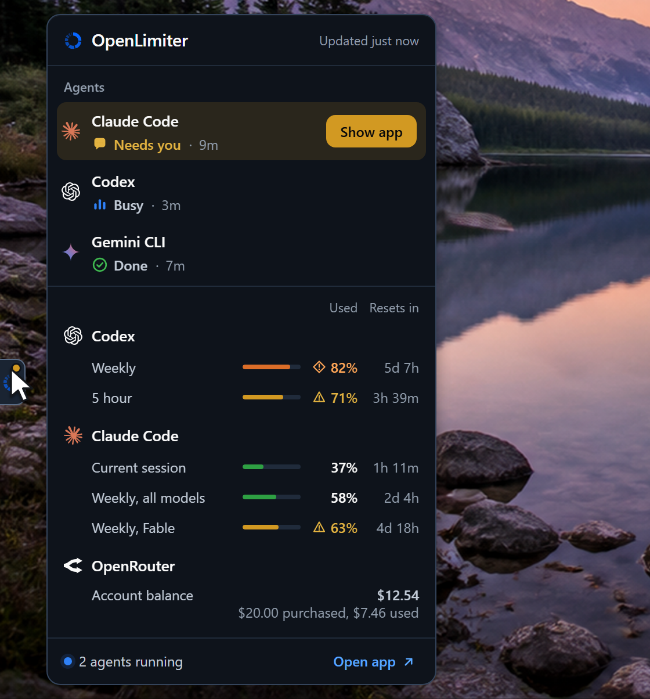

# OpenLimiter

  

OpenLimiter is a free, open source meter that shows how much of each AI coding tool's limit you have used, and when it resets, in a small tab at the edge of your desktop, in the tray and in your terminal.

  

The edge panel with synthetic data. No account identifiers or real usage are shown.

## Download

| System | Download | Notes |
| --- | --- | --- |
| Windows x64 | [Installer](https://github.com/lucaswebsystems/openlimiter/releases/latest/download/OpenLimiter-windows-x64-setup.exe) · [MSI](https://github.com/lucaswebsystems/openlimiter/releases/latest/download/OpenLimiter-windows-x64.msi) | Unsigned. When SmartScreen appears, choose More info, then Run anyway. |
| macOS preview, Apple silicon and Intel | [dmg](https://github.com/lucaswebsystems/openlimiter/releases/latest/download/OpenLimiter-macos-universal.dmg) | Not signed with an Apple Developer ID and not notarised. Drag OpenLimiter to Applications and open it once; macOS blocks it. Then open System Settings, Privacy and Security, choose Open Anyway beside the OpenLimiter message and confirm with your password. Updates on macOS are manual: download the new dmg. |
| Linux x86_64 | [deb](https://github.com/lucaswebsystems/openlimiter/releases/latest/download/OpenLimiter-linux-amd64.deb) · [rpm](https://github.com/lucaswebsystems/openlimiter/releases/latest/download/OpenLimiter-linux-x86_64.rpm) · [AppImage](https://github.com/lucaswebsystems/openlimiter/releases/latest/download/OpenLimiter-linux-x86_64.AppImage) | The AppImage needs libfuse2 (`libfuse2t64` on Ubuntu 24.04). On Wayland, which cannot place the edge tab, the tray takes its place. |
| Any terminal with Node 24 | `npx openlimiter` | Bars in your terminal, no desktop app needed. Install it with `npm install -g openlimiter`. |

**Why the warnings:** the Windows build is unsigned, and the macOS preview is ad hoc signed but not notarised, so neither system can name a publisher. To check a download, compare its SHA256 digest with the one GitHub shows beside each file on the [release page](https://github.com/lucaswebsystems/openlimiter/releases/latest): `certutil -hashfile <file> SHA256` on Windows, `shasum -a 256 <file>` on macOS, `sha256sum <file>` on Linux.

## Get started

1. Download the app for your system and open it, or run `npx openlimiter` in a terminal.
2. Connect your tools. Connect Tools lists the AI coding tools on this computer, and most connect with the login their own tool already stored. OpenLimiter never asks for a vendor password.
3. Watch the bars in the edge tab, the tray and your terminal status line. Desktop alerts arrive at 60, 80 and 90 percent and when a window resets.

Signing in is optional. A free account syncs the same bars to your browser and phone, and Pro adds history and remote alerts.

## What leaves your machine

| | What happens |
| --- | --- |
| **Stays local** | Readings, settings, agent activity and alerts stay on this computer. Claude Code and Antigravity hand their numbers to OpenLimiter through their own documented status lines, with no network request. |
| **Each provider's own request** | The login or key a tool already stored on this computer is used for that provider's own usage request and goes to that provider, nowhere else. Codex answers through its own `codex app-server`. |
| **The Claude request** | Off until you turn it on, and nothing asks you to. Until then, Claude bars come from Claude Code's documented status line. Turn it on with Read my Claude usage from Anthropic in Connect Tools, or with `openlimiter config set providers.claude.poll true` in the terminal: OpenLimiter then sends your own Claude Code login to Anthropic's `api/oauth/usage`, to Anthropic and nowhere else, about every five minutes, and every Claude bar comes from that one source. Anthropic's policy for tools like this is unresolved. Turn it off with the same switch, or with `openlimiter config set providers.claude.poll false`. |
| **Signed in sync** | Nothing goes to OpenLimiter until you sign in. Then sync carries bounded readings: provider, an opaque account label, window, percentage, reset time, the amount and currency of balance meters, and an opaque device identifier, never prompts, code or credentials. Each API spend key adds a row with a random key identifier, the name you gave the key, its provider, the month, the amount spent in US dollars, your budget if you set one, the period that amount covers and whether that period is complete. Sync can be turned off. Separately, with Pro cloud metering, which is opt in, the API spend keys you choose are stored encrypted on the server. |

The desktop app also checks GitHub for updates and asks before installing one. On Windows, the installer downloads Microsoft's WebView2 runtime when it is missing. The local product has no analytics or tracking.

## Connect

| Tool | How it is read | Status |
| --- | --- | --- |
| Claude Code | Its documented status line, plus the Claude request above | Documented |
| Codex | OpenAI's documented `codex app-server`; Codex can also sign in from inside OpenLimiter | Documented |
| Antigravity | The documented Antigravity CLI status line | Documented |
| OpenRouter | The documented key and credits API, with a key you add or OAuth from the hub | Documented |
| Gemini CLI | The login Gemini CLI stored, against an internal Google endpoint | Provisional |
| Grok | The login the Grok CLI stored, against an internal xAI endpoint | Provisional |
| Kimi | The login the Kimi CLI stored, against an internal Moonshot endpoint | Provisional |
| OpenCode | A usage page behind a session you already opened | Provisional |
| Cursor | The local Cursor session, against an internal endpoint | Experimental |
| API spend keys | Each provider's documented cost or balance API, with a key you add | Experimental |

Provisional means the provider does not document the interface, so it can change or stop working without notice. `openlimiter doctor` labels every connector `UNVERIFIED`, and a response that stops matching its expected shape makes that provider unknown rather than a guess. Anthropic's policy for tools like this is unresolved.

OpenLimiter never asks for a vendor password, never impersonates a vendor tool, never writes to a provider's login files and never uploads a subscription login. Every request identifies itself as OpenLimiter. API spend keys live in this device's keyring unless you opt in to cloud metering.

## Terminal

Claude Code, Grok Build and the Antigravity CLI draw bars through their own status line. Codex draws its own built in items instead. Gemini CLI, OpenCode, Kimi and any other terminal read a shell prompt segment. The status line uses the same band colours as the meters. `openlimiter terminal` wires whichever hosts a machine supports, and `openlimiter terminal show` and `terminal hide` pick which connected providers draw a bar.

## Phone

With an account, pair from the hub with a QR code, nothing typed. Add it to your home screen from there: Android offers to install it, and iOS uses Share, then Add to Home Screen. A phone shows the latest synchronised reading, which can be stale when its computer is offline.

## Free and Pro

Free, with no account: local meters, the edge tab, the tray, agent activity, desktop alerts at 60, 80 and 90 percent and at reset, the terminal status line and the command line tool, with one account per provider. A free account adds sync of current readings to your browser and phone. The complete local product is open source under Apache 2.0.

Pro costs USD 5 a month or USD 50 a year, with a 30 day trial and no card required. It adds history, email and phone push alerts, more than one account per provider, and cloud metering for API spend keys. A full refund is available on request within 14 days of a charge. When Pro ends, every connector, meter and alert keeps working for one account per provider, cosmetic presets return to the default look, and nothing is deleted. [PRO.md](PRO.md) sets out what is public, what runs on the private server, and the contract between them.

## Build and contribute

The repository pins Node 24.15.0 and pnpm 9.15.0. The Rust desktop uses the stable toolchain. Start with [CONTRIBUTING.md](CONTRIBUTING.md), and never include a real credential, provider response, account identifier, or machine path in an issue or fixture.

## Project links

[Website](https://openlimiter.com) · [Documentation](https://openlimiter.com/docs) · [Changelog](CHANGELOG.md) · [Security](SECURITY.md) · [Threat model](THREAT_MODEL.md) · [Pro](PRO.md) · [Licence](LICENSE)
